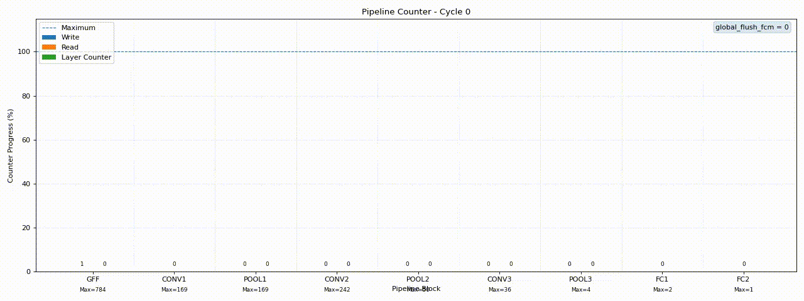

# MNIST CNN ACCELERATOR

## Overview

This project is a streaming, fixed-point RTL accelerator for MNIST digit classification. It receives 8-bit grayscale pixels one at a time and produces a 4-bit class index from **0** to **9** after a complete 28×28 image has been processed.

The network uses valid 3×3 convolutions with stride 1, 2×2 max pooling with stride 2, ReLU, and requantization after each convolution and fully connected stage. The final result comes from an argmax over ten class scores, so the RTL does not need a softmax unit.



| Stage | Output shape |
| --- | --- |
| Input | 28×28×1 |
| Conv1, 3×3, 8 channels | 26×26×8 |
| Pool1, 2×2 | 13×13×8 |
| Conv2, 3×3, 16 channels | 11×11×16 |
| Pool2, 2×2 | 5×5×16 |
| Conv3, 3×3, 32 channels | 3×3×32 |
| Pool3, 2×2 | 1×1×32 |
| FC1 | 16 features |
| FC2 | 10 class scores → argmax |

Weights and biases use signed 16-bit **Q2.14**. Pixels are converted to 24-bit **Q10.14**, and each layer returns to Q10.14 after wider intermediate values have been accumulated and saturated.

## Folder Structure

```
├── 📁 rtl
├── 📁 tb
├── 📁 verifications
│   ├── 📁 python
│   │   ├── 📁 data
│   │   ├── 📁 evaluations
│   │   │   ├── 📁 sim-txt
│   │   │   └── 📄 all_check.ipynb
│   │   ├── 📁 params
│   │   ├── 📄 image-gen.ipynb
│   │   └── 📄 param-gen.ipynb
│   └── 📁 synthetis
├── 📁 xdc
├── 📄 LICENSE
└── 📝 README.md
```

### RTL

The **rtl** folder contains the hardware implementation: the CNN pipeline, its control path, and ROM data for the trained parameters.

- **cnn_accelerator.v** is the integration top level. It receives **clk**, active-low **rstn**, **valid_in**, and 8-bit **din**; it returns **ready_to_upstream**, **valid_argmax**, and 4-bit **class_out**. Send the next pixel only while **ready_to_upstream** is high.
- The **conv**, **pool**, and **fully_connected** layer files implement the network stages listed in the overview.
- Window builders, lane buffers, MAC units, partial accumulators, FIFOs, ReLU, requantizers, and **flush_control_mechanism.v** keep data moving between layers and clear the pipeline between images.
- The Conv and FC weight/bias **.mem** files hold the packed parameter ROM data.

One integration detail: **cnn_accelerator.v** uses **extend_grayscale_pixel** and **argmax_10_class**, but both files currently live in **tb/**. Add them to the design sources, or move them into **rtl/**, before synthesizing the top level.

### TB

The **tb** folder contains Verilog testbenches for the full pipeline, each major layer, and smaller streaming blocks.

- **tb_accuracy_check.v** is the main functional test. It runs 1,000 MNIST images—100 from each class—and writes raw outputs, requantized outputs, and **argmax_prediction.txt**. **imitate_stream_pixels.v** reads **img_test.mem** and drives the valid/ready handshake.
- **tb_latency_check.v** is for observing end-to-end pipeline timing and latency.
- **tb_conv1.v** through **tb_conv3.v**, **tb_pool1.v** through **tb_pool3.v**, and the two fully connected testbenches provide step-by-step layer checks. The remaining testbenches focus on buffers, kernel reconstruction, pooling engines, and control logic.
- **extend_grayscale_pixel.v** expands one pixel into the eight 24-bit input lanes used by Conv1 and converts it to Q10.14. **argmax_10_class.v** picks the largest of the ten final scores.

The memory-file and log-file paths are relative to the simulator's working directory. Make sure **img_test.mem** or **img_buff.mem**, as well as the parameter **.mem** files, are visible from that directory. Copy the generated logs to the evaluation folder when required.

### Verifications

The **verifications** folder holds the Python reference flow and the data used to compare it with RTL simulation.

- **python/data/mnist/** contains the MNIST CSV data. **image-gen.ipynb** selects 100 test images per class and produces 8-bit hexadecimal **.mem** files, including the 1,000-image **img_test.mem** stream used by **tb_accuracy_check.v**.
- **python/params/** contains the exported floating-point model and configuration. **param-gen.ipynb** converts convolution and fully connected parameters to signed Q2.14, packs them into 16-bit ROM words, and generates the Conv and FC memory files.
- **python/evaluations/all_check.ipynb** is the reference and comparison notebook. It rebuilds the CNN in NumPy, reconstructs simulation output into feature maps, compares raw and requantized values per stage, plots channel statistics, and checks argmax results against both the Python model and MNIST labels.
- **python/evaluations/sim-txt/** stores the logs read by the notebook: convolution raw/requantized values, pooling outputs, fully connected outputs, and **argmax_prediction.txt**.
- **synthetis/** is intentionally empty for now. It is reserved for synthesis and implementation reports/logs produced from this RTL. The directory name keeps the repository's existing spelling.

### XDC

The **xdc** folder contains FPGA constraints (Board ARTY 7 100). At the moment, **base.xdc** defines these LVCMOS33 ports:

| Port | Package pin | Constraint |
| --- | --- | --- |
| **clk** | **E3** | 10 ns period (100 MHz), 50% duty cycle |
| **rstn** | **C2** | Active-low reset, declared as a false path |
| **led_4** | **H5** | General-purpose output |
| **led_5** | **J5** | General-purpose output |
| **led_6** | **T9** | General-purpose output |
| **led_7** | **T10** | General-purpose output |

The current accelerator top level has **clk** and **rstn**, but it does not expose the four LED ports. Before implementation, either use a wrapper that drives the LEDs or update **base.xdc** to match the selected top level.

## Result

## Limitations

## Contact

For questions, technical discussions, or additional documentation, feel free to contact me at:

**Email:** alexcinatra.htst@gmail.com

I will be happy to provide clarification and assistance where possible.
